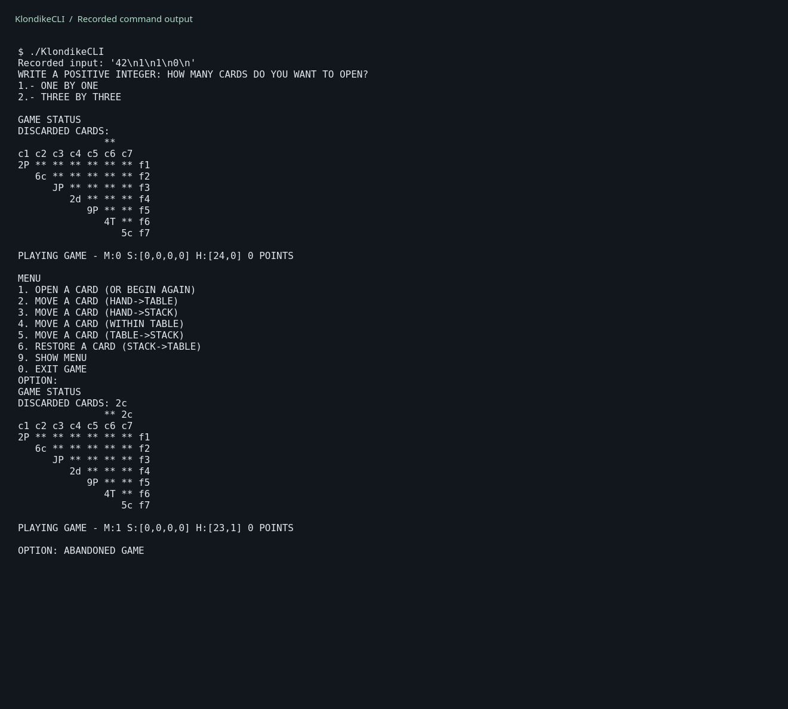

# 🃏 KlondikeCLI


[](LICENSE)
[](https://github.com/Evilchuck666/KlondikeCLI/releases/latest)
[](https://github.com/Evilchuck666/KlondikeCLI/actions/workflows/release.yaml)

**Klondike solitaire in your terminal, written in plain C++17.**

KlondikeCLI is the classic Klondike solitaire played from the console: seven
tableau columns, four foundations, a stock and a waste pile. Each deal comes
from a number you type, so the same seed always gives the same game, on any
system. It keeps track of your moves and score, and refuses any move that
breaks the rules.

It started in 2016 as a university project for a Computer Engineering
programming course, and it shows: every class is documented with
preconditions, postconditions and invariants, and the stack is a hand-written
linked list.

🌐 **Website:** https://evilchuck666.github.io/KlondikeCLI/

<!-- SCREENSHOTS:START -->
## 📸 Screenshots



Recorded output of an actual KlondikeCLI game: seed 42, draw one, one move. The image renders the recorded transcript; it is not a desktop terminal screenshot.

<!-- SCREENSHOTS:END -->

## ✨ Features

- Classic Klondike rules: build the tableau down in alternating colours and
  the foundations up by suit, from Ace to King.
- Draw one card or three cards at a time.
- Seeded deals: the same positive integer always deals the same game.
- Move counter and score, shown after every move.
- Invalid moves are rejected with a message and do not count.
- No dependencies: a single executable for GNU/Linux, Windows and macOS.

## 📥 Download

### Quick install

On **GNU/Linux** or **macOS**, run one of these in a terminal:

```sh
curl -fsSL https://evilchuck666.github.io/KlondikeCLI/install.sh | bash
```

```sh
wget -qO- https://evilchuck666.github.io/KlondikeCLI/install.sh | bash
```

On **Windows**, run this in PowerShell:

```powershell
irm https://evilchuck666.github.io/KlondikeCLI/install.ps1 | iex
```

The installer picks the right package for your system and leaves a shortcut
to KlondikeCLI:

| System | What the installer does |
| --- | --- |
| Arch Linux and derivatives | Installs the `klondikecli-bin` package: with your AUR helper (paru, yay…) when the package is on the AUR, otherwise by building its PKGBUILD with `makepkg`. KlondikeCLI appears in the applications menu. |
| Other GNU/Linux distributions | Installs the binary in `~/.local/bin` and adds KlondikeCLI to the applications menu. |
| macOS (Intel or Apple Silicon) | Installs the binary in `~/.local/bin` and creates `~/Applications/KlondikeCLI.app`, which opens the game in Terminal. |
| Windows | Installs `KlondikeCLI.exe` in `%LOCALAPPDATA%\Programs\KlondikeCLI`, adds it to your PATH and creates Start menu and desktop shortcuts. |

Downloads are checked against `SHA256SUMS.txt`, and no administrator rights
are needed (on Arch, `pacman` asks for `sudo` to install the package). You can
read [install.sh](install.sh) and [install.ps1](install.ps1) before running
them.

### Manual download

| Platform | Latest stable release |
| --- | --- |
| GNU/Linux x64 | [Download](https://github.com/Evilchuck666/KlondikeCLI/releases/latest/download/KlondikeCLI-linux-x64.tar.gz) |
| Windows x64 | [Download](https://github.com/Evilchuck666/KlondikeCLI/releases/latest/download/KlondikeCLI-windows-x64.zip) |
| macOS Intel | [Download](https://github.com/Evilchuck666/KlondikeCLI/releases/latest/download/KlondikeCLI-macos-x64.tar.gz) |
| macOS Apple Silicon | [Download](https://github.com/Evilchuck666/KlondikeCLI/releases/latest/download/KlondikeCLI-macos-arm64.tar.gz) |

[Release notes](https://github.com/Evilchuck666/KlondikeCLI/releases/latest) · [SHA256SUMS.txt](https://github.com/Evilchuck666/KlondikeCLI/releases/latest/download/SHA256SUMS.txt)

On macOS the binary is not signed. If Gatekeeper blocks it, run
`xattr -d com.apple.quarantine KlondikeCLI` once.

## 🚀 Getting started

1. Install KlondikeCLI with the [quick installer](#quick-install), or
   download the package for your system from the
   [table above](#manual-download) and extract it.
2. Open KlondikeCLI from the shortcut the installer created, or run
   `KlondikeCLI` (`KlondikeCLI.exe` on Windows) from a terminal.
3. Type a seed (any positive integer) and choose whether to draw cards one by
   one or three by three.

## 🎮 How to play

### Reading the board

This is the opening deal for seed `42`:

```
GAME STATUS
DISCARDED CARDS:
               **
c1 c2 c3 c4 c5 c6 c7
2P ** ** ** ** ** ** f1
   6c ** ** ** ** ** f2
      JP ** ** ** ** f3
         2d ** ** ** f4
            9P ** ** f5
               4T ** f6
                  5c f7

PLAYING GAME - M:0 S:[0,0,0,0] H:[24,0] 0 POINTS
```

- **Top line:** the top card of the four foundations, then the stock and the
  waste pile. `DISCARDED CARDS` lists the cards you just drew.
- **Tableau:** columns are `c1`–`c7` and rows are `f1`, `f2`… (`f` for
  *fila*, row). Each column is read from `f1` downwards; `**` is a face-down
  card.
- **Status line:** `M` is the number of moves, `S` how many cards each
  foundation holds, `H` the cards left in the stock and in the waste pile,
  followed by the score.

### Cards

A card is its rank followed by its suit:

| Ranks | `A` `2` `3` `4` `5` `6` `7` `8` `9` `D` (10) `J` `Q` `K` |
| --- | --- |
| **Suits** | `P` spades · `c` hearts · `d` diamonds · `T` clubs |

Red suits are lowercase and black suits are uppercase. The letters come from
the Spanish names: *Picas*, *corazones*, *diamantes* and *Tréboles*.

### Menu

| Option | Action | You are asked for |
| --- | --- | --- |
| `1` | Draw one or three cards. When the stock is empty, turn the waste pile over to start again. | — |
| `2` | Move the top waste card to the tableau. | Destination column |
| `3` | Move the top waste card to its foundation. | — |
| `4` | Move a card, and every card on top of it, within the tableau. | Origin column and row, destination column |
| `5` | Move the last card of a column to its foundation. | Origin column |
| `6` | Move a card back from a foundation to the tableau. | Foundation (`1` spades, `2` hearts, `3` diamonds, `4` clubs), destination column |
| `9` | Show the menu again. | — |
| `0` | Give up the game. | — |

You win when all 52 cards are on the foundations.

The points for each move are listed in the [technical guide](TECHNICAL_GUIDE.md#scoring).

## 📚 Learn more

To build from source you need CMake 3.15 or newer and a C++17 compiler:

```sh
cmake -S . -B build -DCMAKE_BUILD_TYPE=Release
cmake --build build --config Release
```

- [Technical guide](TECHNICAL_GUIDE.md): scoring, building from source,
  releases, install scripts and packaging, and project layout.

## ⚖️ License

KlondikeCLI is free software released under the **GNU General Public License v3.0** (GPL-3.0). See [LICENSE](LICENSE).
